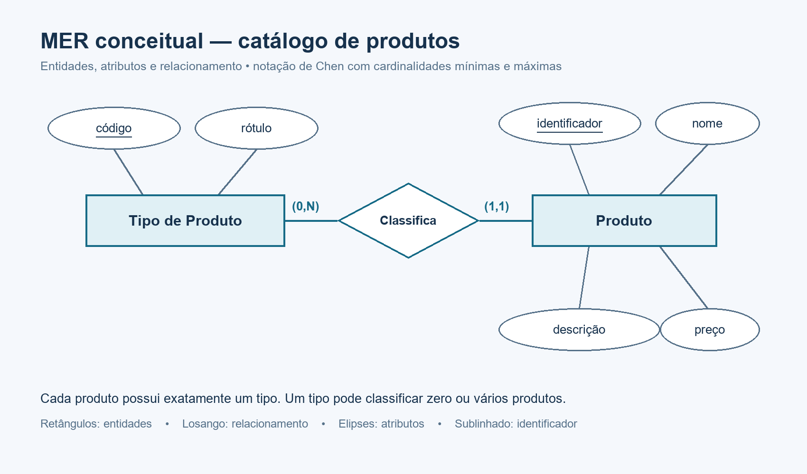
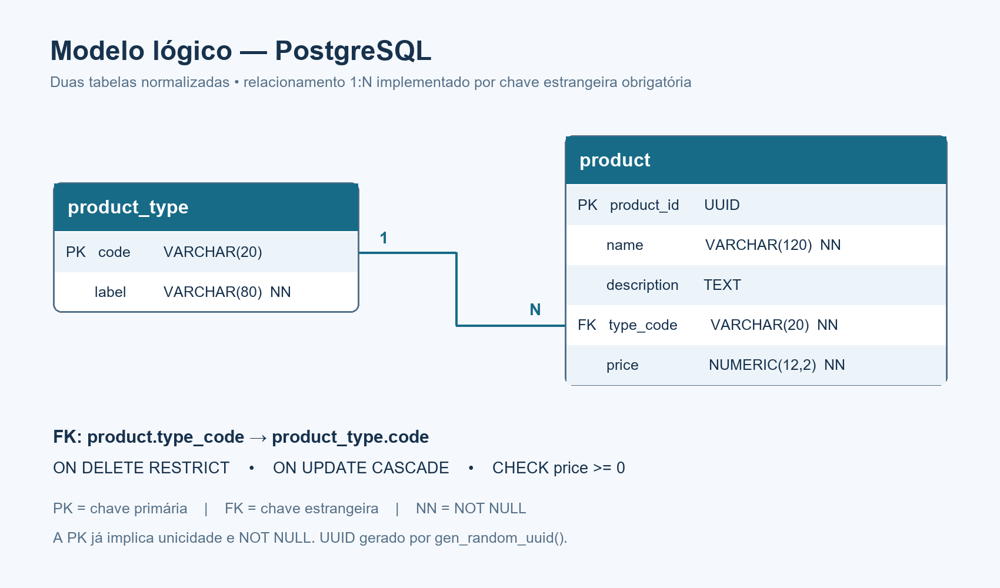

# Modelagem e integridade de dados — Products

Atividade individual de banco de dados baseada no projeto Java **products-master**.
Repositório de destino: [minha-versao-products-master](https://github.com/joseeric26/minha-versao-products-master).

## 1. Contexto e regras do negócio

O projeto de referência contém `ProductModel`, com `productId` (UUID), `name`, `description`, `type` e `price` (BigDecimal). O atributo `type` usa o enum `ProductType`, com oito opções: ELECTRONICS, FOOD, CLOTHING, FURNITURE, BEAUTY, SPORTS, BOOKS e OTHER. A configuração original utiliza H2 em memória.

Para esta atividade foi preparado um **modelo relacional em PostgreSQL**, com as entidades Produto e Tipo de Produto. Os valores do enum tornam-se registros de `product_type`; o produto referencia esse cadastro por FK. Acrescenta-se um rótulo legível ao tipo para demonstrar a normalização de informações descritivas compartilhadas.

Esta entrega contém a modelagem e os scripts SQL. A API Java original permanece como referência: seus mapeamentos JPA e sua configuração H2 não foram migrados por estes scripts. Para integrar a API ao novo modelo, seria necessário mapear Tipo de Produto como entidade, o relacionamento como `@ManyToOne` e configurar o driver e a conexão PostgreSQL.

Regras adotadas:

- Cada produto pertence obrigatoriamente a um único tipo.
- Um tipo pode existir sem produtos e classificar vários produtos.
- O UUID identifica exclusivamente cada produto; o código identifica exclusivamente cada tipo.
- O preço não pode ser negativo; nome e rótulo não podem ser vazios. A descrição é opcional.
- Um tipo com produtos vinculados não pode ser excluído. A alteração de seu código se propaga às FKs.

## 2. MER — modelo conceitual



**Produto** e **Tipo de Produto** são entidades. **Classifica** é o relacionamento 1:N: um tipo classifica de zero a muitos produtos, enquanto cada produto é classificado por exatamente um tipo. Os atributos aparecem como elipses; identificador e código representam identificadores de negócio/conceituais. O MER descreve entidades, atributos, relacionamentos e cardinalidades.

## 3. Modelo lógico relacional



| Tabela | Chave primária | Chave estrangeira | Outros atributos |
| --- | --- | --- | --- |
| `product_type` | `code VARCHAR(20)` | — | `label VARCHAR(80) NOT NULL` |
| `product` | `product_id UUID` | `type_code → product_type.code`, obrigatória | `name VARCHAR(120) NOT NULL`, `description TEXT`, `price NUMERIC(12,2) NOT NULL` |

O relacionamento 1:N é implementado pela FK em `product`. Não existe relacionamento N:N neste escopo. Se um produto pudesse ter vários tipos, seria necessária uma tabela associativa, por exemplo `product_type_link`, com PK composta por `(product_id, type_code)` e duas FKs.

O arquivo [modelo-logico.dbml](docs/modelo-logico.dbml) pode ser importado no [dbdiagram.io](https://dbdiagram.io/) para edição e exportação. As imagens desta entrega foram desenhadas localmente a partir do modelo; não são capturas do dbdiagram.io ou do brModelo. O DDL é a referência executável de todas as restrições.

## 4. DDL, inserções e execução no PostgreSQL

Use uma **base vazia e exclusiva para a atividade**. Os scripts não apagam tabelas. A carga inicial não é idempotente: execute-a uma única vez na base nova. Para repetir apenas a verificação, execute novamente `03_testes.sql`.

Arquivos, na ordem:

1. [01_ddl.sql](sql/01_ddl.sql): cria as duas tabelas, PKs, FK, verificações e índice.
2. [02_dados.sql](sql/02_dados.sql): insere oito tipos e três produtos; dois produtos compartilham ELECTRONICS e outro referencia BOOKS.
3. [03_testes.sql](sql/03_testes.sql): comprova os relacionamentos e as rejeições de registros inválidos.

Com `psql` instalado, crie a base e execute, a partir da raiz desta entrega:

```sh
createdb -h localhost -U postgres products_atividade
psql -X -h localhost -U postgres -d products_atividade -v ON_ERROR_STOP=1 -f sql/01_ddl.sql -f sql/02_dados.sql -f sql/03_testes.sql
```

O usuário deve ter permissão para criar a base; se ela já foi criada pelo administrador, execute somente o segundo comando. As credenciais são solicitadas pelo PostgreSQL; nenhuma senha é incluída na entrega.

Alternativa com Docker, usando um contêiner isolado e sem porta publicada:

```sh
docker run --name products-atividade --network none -e POSTGRES_HOST_AUTH_METHOD=trust -e POSTGRES_DB=products_atividade -d postgres:17
docker exec products-atividade pg_isready -U postgres -d products_atividade
docker cp sql products-atividade:/tmp/sql
docker exec products-atividade psql -X -U postgres -d products_atividade -v ON_ERROR_STOP=1 -f /tmp/sql/01_ddl.sql -f /tmp/sql/02_dados.sql -f /tmp/sql/03_testes.sql
```

Aguarde `pg_isready` indicar `accepting connections` antes do último comando. A autenticação `trust` é utilizada somente nessa demonstração isolada, sem acesso de rede. Para encerrar a instância: `docker stop products-atividade`.

No pgAdmin, selecione uma base vazia e execute os três arquivos, na mesma ordem, pelo Query Tool.

### Comprovação dos relacionamentos

```sql
SELECT p.name, p.price, t.code, t.label
FROM product p
JOIN product_type t ON t.code = p.type_code
ORDER BY p.product_id;
```

| Produto | Preço | Tipo | Rótulo |
| --- | ---: | --- | --- |
| Teclado USB | 120.00 | ELECTRONICS | Eletronicos |
| Mouse USB | 60.00 | ELECTRONICS | Eletronicos |
| Livro de SQL | 85.00 | BOOKS | Livros |

## 5. Bônus — violações de integridade

O teste tenta inserir um produto com `type_code = 'INEXISTENTE'`: o PostgreSQL rejeita a operação com **SQLSTATE 23503**, violação da FK `fk_product_type`. Também tenta repetir o UUID do Teclado USB: o PostgreSQL rejeita com **SQLSTATE 23505**, violação da PK `pk_product`.

Além disso, verifica que a exclusão de ELECTRONICS é bloqueada enquanto houver produtos relacionados e que um preço negativo é rejeitado pelo CHECK, com SQLSTATE 23514.

Os erros reais são capturados em blocos PL/pgSQL e apresentados como `NOTICE`, com mensagem e detalhes do servidor. Cada tentativa inválida é desfeita pela subtransação do bloco `EXCEPTION`. Se uma operação inválida for aceita, o teste lança uma exceção e falha. Ao final, confirma-se que permanecem oito tipos e três produtos. Não basta apenas imprimir uma mensagem de sucesso.

A saída real da execução está em [docs/evidencias-postgresql.txt](docs/evidencias-postgresql.txt).

## 6. Desafio de normalização

Considere esta tabela hipotética anterior à normalização, na qual o rótulo do tipo era repetido em todos os produtos. Ela é um exemplo didático; o Java original já utilizava um enum e não armazenava esse rótulo duplicado.

**Produto_Desnormalizado**

| product_id | name | type_code | type_label | price |
| --- | --- | --- | --- | ---: |
| P1 | Teclado USB | ELECTRONICS | Eletronicos | 120.00 |
| P2 | Mouse USB | ELECTRONICS | Eletronicos | 60.00 |
| P3 | Livro de SQL | BOOKS | Livros | 85.00 |

P1, P2 e P3 são abreviações dos UUIDs apenas para facilitar a leitura. As dependências funcionais relevantes são:

```text
product_id → name, description, price, type_code
type_code → type_label
product_id → type_code → type_label   (dependência transitiva)
```

Anomalias dessa estrutura:

- **Inserção:** não seria possível cadastrar o tipo SPORTS sem inventar um produto ou permitir um registro incompleto.
- **Atualização:** alterar o rótulo de ELECTRONICS exigiria atualizar todos os produtos desse tipo; uma linha esquecida criaria rótulos divergentes.
- **Exclusão:** apagar o último produto do tipo BOOKS também eliminaria a única informação de que esse tipo se chama Livros.

Aplicação das formas normais:

1. **1FN:** cada célula contém um valor atômico, cada produto tem um identificador e cada produto possui apenas um tipo. Não se armazenam listas de tipos em uma coluna.
2. **2FN:** os atributos não chave dependem da chave inteira. Como a PK de Produto é simples (`product_id`), não há dependência parcial de uma chave composta.
3. **3FN:** remove-se `type_label` de Produto e cria-se `product_type(code, label)`. Em `product`, os atributos não chave dependem de `product_id`; em `product_type`, o rótulo depende diretamente de `code`. Elimina-se a dependência transitiva do rótulo em relação ao identificador do produto.

Após a decomposição, o rótulo é armazenado uma vez por tipo, pode ser atualizado em um único lugar e continua existindo mesmo sem produtos. O JOIN reconstrói a informação completa. A FK garante que os códigos usados pelos produtos estejam cadastrados.

Ter um enum, por si só, não implica violação da 3FN. A dependência transitiva demonstrada é a do **rótulo descritivo repetido** no exemplo hipotético. A tabela de tipos também fornece um relacionamento explícito para testar a integridade referencial.

Não há `Valor_Total` armazenado neste domínio. Caso se acrescentem pedidos e quantidades, valores derivados podem ser calculados em consultas; qualquer armazenamento por desempenho exigiria uma regra explícita de manutenção da consistência.

## 7. Parte 4 — reflexão

**Por que a normalização (até a 3FN) é crucial para evitar anomalias de inserção, atualização e exclusão? Qual o papel da Chave Primária (PK) e da Chave Estrangeira (FK) para garantir a integridade dos dados?**

A normalização organiza os dados de acordo com suas dependências, reduzindo redundância e inconsistências. Até a 3FN, removem-se grupos repetidos, dependências parciais e dependências transitivas indevidas. Assim, cada informação é mantida no lugar que representa seu significado: o rótulo de um tipo fica no cadastro do tipo, e o preço de um produto fica no produto.

Isso permite inserir um tipo sem criar um produto fictício, atualizar seu rótulo uma única vez e excluir um produto sem perder o cadastro do tipo. A normalização reduz as anomalias estruturais, mas também precisa ser acompanhada de restrições e regras de negócio.

A **PK** identifica unicamente cada registro e não admite valores nulos nem duplicados. Nesta atividade, `product.product_id` identifica o produto e `product_type.code` identifica o tipo. A **FK** exige que o tipo referenciado pelo produto exista; combinada com `NOT NULL`, torna esse vínculo obrigatório. A política `ON DELETE RESTRICT` bloqueia a exclusão de um tipo em uso, evitando produtos órfãos. Assim, as chaves garantem unicidade e integridade dos relacionamentos em um sistema transacional (OLTP).

## Arquivos da entrega

```text
README.md
sql/
  01_ddl.sql
  02_dados.sql
  03_testes.sql
docs/
  mer-conceitual.png
  modelo-logico.png
  modelo-logico.dbml
  evidencias-postgresql.txt
```

As imagens distinguem o MER conceitual do modelo lógico com tabelas, PKs e FK. Os scripts e as evidências permitem reproduzir a parte prática independentemente da execução da API Java.
